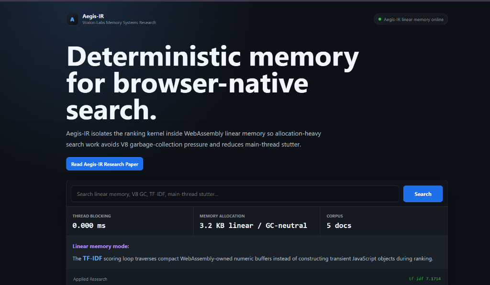
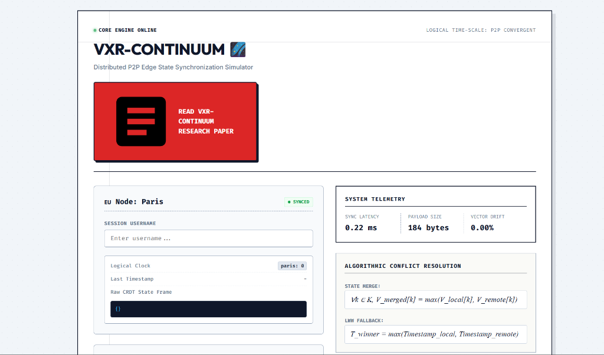
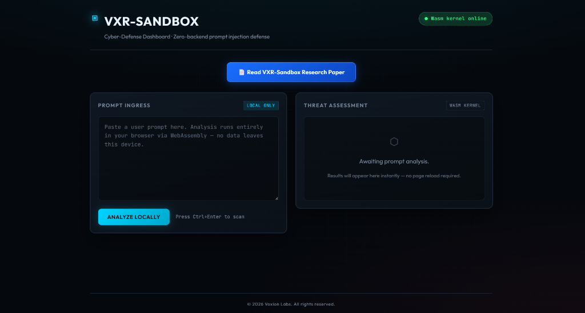

  

  <b>Independent research syndicate</b> 
  Focusing on stateful AI orchestration, zero-backend networks, and sandboxed AI kernels.

  
  
  
  

---

## Overview

Voxion Labs is an independent research syndicate and repository hub focused on Machine Learning, Data Science, and stateful AI orchestration. The primary objective of this organization is to bypass conventional cloud dependencies by engineering zero-backend architectures, distributed state engines, and local-first AI sandboxes.

Core development involves optimizing neural networks and data pipelines using Python, integrated securely with low-latency WASM kernels and bare-metal C/C++ backplanes. Repositories maintained under this organization operate on a strictly utilitarian thesis: translating theoretical computer science and machine intelligence models into production-grade infrastructure, executing under absolute isolation protocols and zero-overhead performance benchmarks.

---

## Voxion eXperimental Research (VXR)

> *Active research divisions focusing on browser-native, zero-backend, and deterministic memory isolation architectures.*

<table>
  <tr>
    <td width="48%" valign="top">
      
    </td>
    <td width="4%"></td>
    <td width="48%" valign="top">
      <h4><a href="https://github.com/Voxion-Labs/Aegis-IR">Aegis-IR</a></h4>
      <b>Deterministic Memory for Browser-Native Search</b>  
      Isolates the ranking kernel inside WebAssembly linear memory. Bypasses V8 garbage-collection to eliminate main-thread stutter. Recorded at low thread blocking with a GC-neutral 3.2 KB linear memory allocation.
        
      <code>C++</code> &nbsp; <code>WebAssembly</code> &nbsp; <code>Zero-GC</code>
    </td>
  </tr>
  <tr><td colspan="3"> </td></tr>
  <tr>
    <td width="48%" valign="top">
      
    </td>
    <td width="4%"></td>
    <td width="48%" valign="top">
      <h4><a href="https://github.com/Voxion-Labs/VXR-Continuum">VXR-Continuum</a></h4>
      <b>Distributed P2P Edge State Synchronization</b>  
      Client-side engine demonstrating state synchronization across edge networks. Employs CRDT algorithmic conflict resolution. Benchmarked at 0.22 ms sync latency and lowest vector drift across P2P logical timestamps.
        
      <code>Python</code> &nbsp; <code>CRDT</code> &nbsp; <code>P2P Telemetry</code>
    </td>
  </tr>
  <tr><td colspan="3"> </td></tr>
  <tr>
    <td width="48%" valign="top">
      
    </td>
    <td width="4%"></td>
    <td width="48%" valign="top">
      <h4><a href="https://github.com/Voxion-Labs/VXR-Sandbox">VXR-Sandbox</a></h4>
      <b>Cyber-Defense Dashboard · Zero-Backend Defense</b>  
      Browser-native deterministic sandboxing kernel for detecting LLM prompt injections. Threat assessment executes strictly on-device via the Wasm kernel, preventing data ingress from exiting the local environment.
        
      <code>WebAssembly</code> &nbsp; <code>Cyber-Defense</code> &nbsp; <code>Local-Only</code>
    </td>
  </tr>
</table>

---

## Technical Infrastructure

<table align="center">
  <tr>
    <td align="center" width="100"> <b>Python</b></td>
    <td align="center" width="100"> <b>C++</b></td>
    <td align="center" width="100"> <b>C</b></td>
    <td align="center" width="100"> <b>WebAssembly</b></td>
  </tr>
  <tr>
    <td align="center" width="100"> <b>Docker</b></td>
    <td align="center" width="100"> <b>MySQL</b></td>
    <td align="center" width="100"> <b>Go</b></td>
    <td align="center" width="100"> <b>Git</b></td>
  </tr>
</table>

---

## Network & Contact

| Platform | Handle | Description |
| :--- | :--- | :--- |
|  LinkedIn | <a href="https://www.linkedin.com/company/voxionlabs/"><b>Voxion Labs</b></a> | For updates and announcements |
|  Instagram | <a href="https://www.instagram.com/voxionlabs/"><b>@voxionlabs</b></a> | Research updates & behind-the-scenes |
|  X | <a href="https://x.com/voxionlabs"><b>@voxionlabs</b></a> | Discovery and main frame |
| Email | <a href="mailto:voxionlabs.inc@outlook.com"><b>voxionlabs</b></a> |  Lab & project communications |
| Founder | <a href="https://github.com/R-Jena"><b>R-Jena</b></a> | Founder's GitHub |

---

## Systems & Ecosystem

> *Production environments and autonomous systems developed and maintained under Voxion Labs.*

<table width="100%">
  <tr>
    <td width="50%" valign="top">
       
      <b><a href="https://github.com/Voxion-Labs/VoidLAB">VoidLAB</a></b> 
      <i>Zero Backend Browser Cloud IDE</i>
      

      A sandbox-isolated browser IDE for seamless cross-platform developer workflows. Features a multi-tab workspace, responsive file explorer, background compile threads via web workers, and multi-language execution — all operable from any device without installation.
        
      <b>Stack</b> 
      Go · Wasm · Socket.io · Docker
        
    </td>
    <td width="50%" valign="top">
       
      <b><a href="https://github.com/Voxion-Labs/FluxKernel">FluxKernel</a></b> 
      <i>Memory-Driven AI OS Agent</i>
      

      A persistent, memory-driven AI agent that operates directly on local filesystems. Routes tasks between cloud LLMs and local models using self-correcting git-diff patches, with a semantic vector memory backplane that maintains full context continuity across sessions.
        
      <b>Stack</b> 
      Python · LangChain · Go · Docker
        
    </td>
  </tr>
</table>

 

<table width="100%">
  <tr>
    <td width="50%" valign="top">
       
      <b><a href="https://github.com/Voxion-Labs/YooMates">YooMates</a></b> 
      <i>Unified Collaborative Workspace</i>
      

      Unified collaboration platform that combines real-time team communication, a public social feed and a private knowledge and execution workspace.
        
      <b>Stack</b> 
      Go · Socket.io · Typescript · Wasm
        
    </td>
    <td width="50%" valign="top">
       
      <b><a href="https://github.com/Voxion-Labs/LEXIO">LEXIO</a></b> 
      <i>Text-To-Speech Engine</i>
      

       A browser-native document narration and speech engineering workstation built with Go WebAssembly and web standards. Operates without remote server roundtrips, executing all document ingestion, phrase segmentation, speech synthesis directly on the browser
        
      <b>Stack</b> 
      Go · Web Speech API · Wasm
        
    </td>
  </tr>
</table>

 

<table width="100%">
  <tr>
    <td width="50%" valign="top">
       
      <b><a href="https://github.com/Voxion-labs/SkillNODE">SkillNODE</a></b> 
      <i>Social Skill Acquisition Platform</i>
      

      A full-stack monorepo web application for structured cognitive and technical skill training. It consolidates multi-domain practice environments, persistent user identity, challenge-based execution, AI coaching, fair-play monitoring, and real-time multiplayer into a single cohesive platform.
        
      <b>Stack</b> 
      Wasm · Go · Docker 
        
    </td>
    <td width="50%" valign="top">
       
      <b><a href="https://github.com/Voxion-Labs/RedTerminal">RedTerminal</a></b> 
      <i>C-Based OS Process Simulator</i>
      

      A workstation operating directly in the browser and as a toggleable Manifest V3 overlay extension for security analysis, data crunching, and WebAssembly execution.
        
      <b>Stack</b> 
      C · POSIX Threads · Go · Wasm
        
    </td>
  </tr>
</table>

 

<table width="100%">
  <tr>
    <td colspan="2" valign="top">
       
      <b><a href="https://github.com/Voxion-Labs/Aabhas">Aabhas</a></b> 
      <i>Shadow Memory Grid & Tensor Streaming Engine</i>
      

       A memory allocator and out-of-core tensor streaming engine designed for large language model inference. It utilizes a C++/Rust core to bypass standard OS page-table overhead, enabling direct NVMe-to-CPU layer drops enforcing strict memory caps and adaptive I/O scheduling to maintain host OS stability while executing massive parameter models.
        
      <b>Stack</b> 
      Go · Rust · C++ · Docker
        
    </td>
  </tr>
</table>

---

## Operational Protocols & Governance

* **Licensing & Architecture:** Foundational systems and non-classified VXR kernels are maintained under our custom institutional license. Refer to the [Voxion Labs Proprietary Research License (VL-MPL)](https://github.com/Voxion-Labs/.github/blob/main/LICENSE) for strict operational parameters.
* **External Collaboration:** Voxion Labs enforces ruthless pull-request auditing. Independent developers must strictly adhere to our [Contribution Directives & Architectural Standards](https://github.com/Voxion-Labs/.github/blob/main/CONTRIBUTING.md) before initiating merge requests.
* **Security & Vulnerability Disclosure:** For zero-day reports, prompt-injection bypasses, or critical vulnerabilities within VXR sandboxes, do not open public issues. Follow internal security disclosure protocols.

---

<h2 align="center">OUR APPROACH</h2>

<table width="100%">
  <tr>
    <td width="33%" align="center" valign="top">
       
      <b>Build</b>
        
      Construct bare-metal systems and resilient infrastructure.
        
    </td>
    <td width="34%" align="center" valign="top">
       
      <b>Break</b>
        
      Stress-test architectures to expose limits and vulnerabilities.
        
    </td>
    <td width="33%" align="center" valign="top">
       
      <b>Optimize</b>
        
      Analyze execution telemetry to eliminate computational overhead.
        
    </td>
  </tr>
</table>

  <b>Build → Break → Analyze → Optimize</b>

---

## Vision & Future Projections

**Vision Directive**
The computing paradigm is shifting from passive applications to autonomous, self-correcting systems. Voxion Labs envisions an infrastructure where operating environments and AI models co-evolve directly on edge devices—eliminating centralized compute latency and enforcing strict data determinism.

**Strategic Projections**
* **Phase I (Current):** Establishing deterministic sandboxes and WebAssembly-based execution kernels for secure, local AI orchestration.
* **Phase II:** Deployment of distributed, zero-backend state synchronization networks capable of maintaining continuous multi-agent memory across P2P nodes.
* **Phase III:** Architectural transition to stateful, memory-driven AI Operating Systems functioning entirely on client-side computational power.

---

 

  <i>Architecture & Infrastructure maintained by</i> 
  <b><a href="https://github.com/R-Jena">Rudranarayan Jena</a></b> 
  Founder of Voxion Labs

 

  

